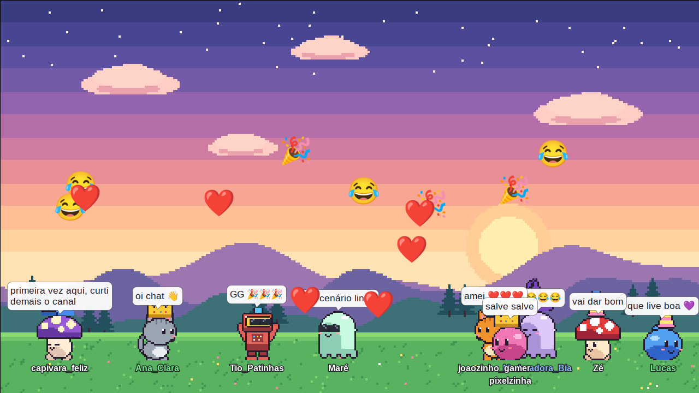

# Kikarinhas

**Português** · [English](README.md)

Avatares do chat andando na sua live: cada pessoa que fala no chat ganha um
bonequinho que passeia, pula e reage numa janela transparente que o OBS
captura. Parecido com o Stream Avatars e o Desktop Ponies, mas nativo para
Linux (X11) e leve: C, Cairo e Pango.

> **Fases 4, 5 e 7 (em parte).** Lê o chat público de uma live do YouTube,
> da Twitch, do Kick ou do Odysee (sem login nem chave): cada pessoa que
> fala ganha um avatar do Stream Avatars,
> que pula e mostra a mensagem num balão. Pelo chat, cada um escolhe avatar,
> cor e acessórios (guardados para a próxima live), manda o avatar dançar,
> sentar, abraçar ou atacar, e toca sons da mesa de som. Os emojis do chat,
> os emotes de membros do YouTube, os da Twitch (inclusive BTTV, FFZ e 7TV),
> do Kick (e 7TV) e do Odysee e as reações do YouTube voam pela tela (emote
> wall).
> Tudo se configura num `.ini` ou no `kikarinhas-config`, que também lista
> os espectadores. Outros programas mandam mensagens por um socket unix. Veja o
> [PLANO.md](PLANO.md).



O mesmo chat como **danmaku**, voando da direita para a esquerda (veja
[Danmaku](#danmaku)):


*Os avatares são o pacote padrão que vem com o kikarinhas, sobre um cenário
feito com o recurso de cenário; as pessoas e as falas são inventadas
(`tools/screenshots.py` tira estas imagens).*

## Compilar

Dependências (Debian/Ubuntu):

```sh
sudo apt install build-essential pkg-config libx11-dev libxext-dev \
    libcairo2-dev libpango1.0-dev libcurl4-openssl-dev libasound2-dev \
    libssl-dev libdbus-1-dev
sudo apt install libgtk2.0-dev   # opcional: só para o kikarinhas-config
sudo apt install fonts-noto-color-emoji   # emojis coloridos (emote wall e balões)
```

A fonte de emoji é usada só na hora de rodar; sem ela (ou outra fonte de
emoji colorido), os emojis aparecem em branco, sem cor. Para quem mexe no
código: `tools/gen_emoji_table.py` regenera `src/emoji_table.h` a partir do
`emoji-data.txt` do pacote `unicode-data` (só quando sair um Unicode novo).

```sh
make            # gera build/kikarinhas (e build/kikarinhas-config, com GTK2)
make test       # testes de unidade
make asan       # testes com AddressSanitizer/UBSan
make asan-run   # o programa com AddressSanitizer/UBSan
```

Para instalar o que você compilou (sem `PREFIX`, vai para `/usr/local`):

```sh
sudo make install PREFIX=/usr
sudo make uninstall PREFIX=/usr
```

Isso põe no lugar os mesmos arquivos do `.deb` (o `kikarinhas-config` só se foi
compilado, com GTK2). O `tools/build-deb.sh` gera um `.deb` a partir da árvore.

## Instalar

O jeito mais fácil é o pacote `.deb` da
[página de releases](https://github.com/kiyoshispreclerg/kikarinhas/releases).
Cada release tem um para Ubuntu 22.04, Ubuntu 24.04, Devuan 5 "daedalus"
(serve também no Debian 12) e Devuan 6 "excalibur" (serve também no Debian
13); escolha o do seu sistema. Os nomes são
`kikarinhas_VERSÃO-1_SISTEMA_ARQ.deb`, e cada um foi instalado e executado num
sistema limpo do mesmo tipo antes de ser publicado.

```sh
sudo apt install ./kikarinhas_0.4.0-1_ubuntu24.04_amd64.deb   # use o arquivo que você baixou
sudo apt remove kikarinhas
```

O `apt` traz as bibliotecas necessárias. O pacote instala `kikarinhas` e
`kikarinhas-config`, o `.ini` de exemplo em `share/doc/kikarinhas/`, o pacote
padrão de avatares, os atalhos `.desktop` e o ícone, então os dois programas
aparecem nos menus e buscadores de aplicativos (o configurador como
"Configurações do Kikarinhas"). Se o menu não mostrar na hora, rode
`update-desktop-database` ou saia e entre na sessão. Para emojis coloridos,
instale também `fonts-noto-color-emoji`.

Para instalar a partir do código-fonte, veja [Compilar](#compilar).

## Usar

Os avatares vêm de várias pastas, lidas nesta ordem (com nome repetido, vale
a primeira, então um avatar seu pode substituir um do Stream Avatars):

1. a sua, `~/.local/share/kikarinhas/avatars` (o botão **Abrir a minha pasta
   de avatares** do `kikarinhas-config` cria e abre);
2. as de `paths` no `.ini` (`--avatar-dir`, ou **Outras pastas de avatares**
   na aba Avatares), na ordem dada;
3. a instalação do Stream Avatars (a pasta `data` dentro do prefixo do
   Proton), procurada nas bibliotecas do Steam; se não for achada, indique
   com `--sa-dir`, e `sa_dir = off` desliga. Nada é copiado nem alterado lá;
4. as **pastas do sistema**, `kikarinhas/avatars` em cada diretório de dados
   (`/usr/share`, `/usr/local/share` e os outros de `$XDG_DATA_DIRS`), um kit
   por subpasta: onde o programa instala o pacote padrão e onde um `.deb` ou
   outro instalador pode pôr kits novos para todos da máquina.

Cada pasta pode ter uma pasta de dados (`streamavatars_json.txt`), um pacote
(`data.txt`, o formato dos `.zip` do SA, já descompactado) ou subpastas com
eles. Sem o Stream Avatars, o kikarinhas roda com o que houver nas outras.

**Um pacote padrão pequeno vem com o kikarinhas** e é o que aparece numa
instalação nova: cinco personagens (gato, slime, robô, fantasma e cogumelo)
com três cores cada, e chapéus, óculos e poltronas para vestir (`!gear
coroa`...), todos desenhados para o projeto (`data/avatars/default`,
instalado em `/usr/share/kikarinhas/avatars/default`; o
`tools/gen_default_avatars.py` desenha). Os avatares das pastas do sistema
ficam à disposição de todos (`!avatar gato`, `!avatar random`), mas não são
sorteados por hash como avatar padrão de ninguém enquanto houver outros:
ter os seus ou o do Stream Avatars, ou instalar um kit novo, nunca muda a
cara de quem nunca escolheu.

Quer **criar os seus próprios avatares, acessórios e paletas**? O formato é o
do Stream Avatars e está explicado em [docs/avatares](docs/avatares/README.md)
(em português), com um kit de exemplo que funciona.

```sh
build/kikarinhas -y https://www.youtube.com/watch?v=ID   # chat de uma live
build/kikarinhas -y @SeuCanal           # espera o canal entrar ao vivo
build/kikarinhas -t seucanal            # chat da Twitch
build/kikarinhas -k seucanal            # chat do Kick
build/kikarinhas -o @SeuCanal           # Odysee: espera o canal entrar ao vivo
build/kikarinhas -y @SeuCanal -t seucanal -t outrocanal   # várias lives juntas
build/kikarinhas --demo-chat            # chat de mentira, para testar
build/kikarinhas                        # 6 avatares sorteados, janela 1280x720
build/kikarinhas -n 20 -s 1920x1080     # 20 avatares em 1080p
build/kikarinhas -a pikachu -a crewmate # avatares escolhidos
build/kikarinhas -m desktop             # sobre o desktop, o clique atravessa
build/kikarinhas --list                 # lista os avatares encontrados
build/kikarinhas --check                # confere todas as spritesheets
```

| Opção | |
|---|---|
| `-m, --mode obs\|desktop` | `obs` (padrão): janela comum para capturar; `desktop`: sobreposição em tela cheia, sem receber cliques |
| `-s, --size LxA` | tamanho da janela no modo `obs` (padrão `1280x720`) |
| `-f, --fps N` | quadros por segundo (padrão 30) |
| `-y, --youtube ALVO` | link da live ou do canal, `@handle` ou id do vídeo |
| `-t, --twitch CANAL` | canal da Twitch: o nome ou o link `twitch.tv/canal` |
| `-k, --kick CANAL` | canal do Kick: o nome ou o link `kick.com/canal` |
| `-o, --odysee ALVO` | Odysee: link da live ou do canal, `@canal` ou o id da live (claim id) |
| `--demo-chat` | chat de mentira com gente inventada |
| `--chat-window` | abre a janela de chat clássico (veja [Janela de chat](#janela-de-chat)) |
| `--max N` | avatares do chat ao mesmo tempo (padrão 30); quem está calado há mais tempo sai primeiro |
| `--despawn S` | segundos em silêncio até o avatar sair (padrão 300) |
| `-d, --default-avatar NOME` | todos usam este avatar (padrão: um sorteado por pessoa, sempre o mesmo) |
| `-v, --verbose` | mostra as mensagens no terminal |
| `--users ARQ` | onde guardar as escolhas de cada pessoa |
| `--import-sa-users` | importa as escolhas do Stream Avatars de novo |
| `--sa-dir PASTA\|off` | pasta `data` do Stream Avatars; `off` não usa o SA |
| `--avatar-dir PASTA` | outra pasta de avatares (pode repetir) |
| `-n, --count N` | avatares sorteados fora do chat (padrão 6, ou 0 com chat ou `-a`) |
| `-a, --avatar NOME` | mostra este avatar; pode repetir |
| `--scale X` | escala dos avatares (padrão 2) |
| `--ground N` | pixels entre o chão e a borda de baixo (padrão: espaço do nome) |
| `--seed N` | semente do sorteio, para repetir a mesma cena |
| `-c, --config ARQ` | arquivo de configuração (padrão `~/.config/kikarinhas/kikarinhas.ini`) |
| `--socket CAMINHO\|off` | socket de controle (padrão `$XDG_RUNTIME_DIR/kikarinhas.sock`) |
| `--reload` | pede ao kikarinhas aberto para reler a configuração e sai |

Dá para ler várias lives ao mesmo tempo, de uma plataforma ou de várias:
repita `-y`/`-t`/`-k`/`-o`, separe por vírgula no `.ini` (`youtube = @um,
@dois`, `twitch = canal1, canal2`, `kick = ...`, `odysee = ...`) ou use o
botão **Adicionar** da aba Chat do
`kikarinhas-config`, que vai juntando as lives numa lista (e reconhece a
plataforma pelo link). Os avatares e emotes de todas aparecem juntos;
a mesma pessoa em duas lives da mesma plataforma é um avatar só. Com `-v`,
cada mensagem diz de onde veio (`[twitch #canal]`, `[youtube @handle]`,
`[kick kick.com/canal]`, `[odysee @canal]`). No
`reload`, só as lives que entraram ou saíram da lista conectam ou
desconectam.

Clique com o botão direito na janela (modo `obs`) para abrir o
`kikarinhas-config` com o mesmo `.ini`; só abre um por vez.

Com o botão esquerdo (também só no modo `obs`; no `desktop` o clique passa
para a área de trabalho), clique num avatar para ele pular, ou pegue e
arraste: ele fica pendurado no ponteiro, balançando enquanto você carrega, e
sai voando com a velocidade com que você soltou, quicando nas paredes como no
`!sling`.

### Idiomas do configurador

O `kikarinhas-config` fala o idioma da sessão (`LANGUAGE`, `LC_ALL` ou
`LANG`): português do Brasil (`pt_BR`) e inglês (`en`; qualquer outro
idioma cai no inglês). O `kikarinhas` em si não tem textos de interface.
Para acrescentar um idioma, adicione o código em `po/LINGUAS`, crie o `.po`
com `msginit -l xx -i po/kikarinhas.pot -o po/xx.po`, traduza e rode `make`
(os `.mo` saem em `build/locale`, que o programa acha ao lado do executável;
`make install` os instala). Depois de mudar textos no código, `make pot`
atualiza o `.pot` e mescla nos `.po`.

Para sair: feche a janela ou use Ctrl+C. No modo `desktop`, que não recebe
cliques, use `pkill kikarinhas` ou `echo quit | socat - UNIX-CONNECT:$XDG_RUNTIME_DIR/kikarinhas.sock`.

### Configuração

Tudo o que as opções fazem também pode ficar em
`~/.config/kikarinhas/kikarinhas.ini`; as opções da linha de comando valem
por cima do arquivo. O [data/kikarinhas.ini](data/kikarinhas.ini) explica
cada chave. O jeito mais fácil de editar é o `kikarinhas-config` (GTK2):
abas Janela, Avatares, Avatares instalados, Chat, Comandos, Sons, Emote wall
e Espectadores, e o botão **Salvar e aplicar**. Ele mantém os comentários do
arquivo e só grava o que for diferente do padrão. A aba **Avatares
instalados** lista os avatares de todas as pastas, com miniatura, tamanho da
célula, animações (as que o `!emote` aceita), paletas, conjuntos de gear e a
pasta de onde cada um veio, com busca. Na aba **Comandos**, clicar duas
vezes num comando (ou **Editar**) abre um diálogo com o que a ação dele
precisa: o texto de um comando de texto, a imagem com a posição, o tamanho e
uma prévia de onde ela fica na janela, o som, o avatar, o filtro de player
do `!song`, a espera e o nível mínimo.

Na aba Avatares, `show_names`/`name_position` (embaixo ou em cima do
avatar) e `show_bubbles` ligam ou desligam o nome e o balão com a mensagem
de cada um. `name_idle_hide`/`name_idle_seconds` escondem o nome depois de
tantos segundos sem atividade (chegada, mensagem, comando ou balão), deixando
só o desenho; é separado do `despawn`, que remove o avatar. `name_font`/`name_size` e `bubble_font`/`bubble_size` trocam a
fonte (família e estilo do Pango, como `Sans Bold`) e o tamanho em pontos do
nome e do balão.

Para aplicar sem fechar o programa: **Salvar e aplicar**, `kikarinhas
--reload` ou `kill -HUP`. Comandos, avatar padrão, limite de avatares,
tempo de sumiço, fps, chat de mentira, `verbose`, as lives (YouTube,
Twitch, Kick e Odysee), nomes/posição, balões e a fonte dos balões mudam na hora. Tamanho, modo,
escala, chão, avatares fixos, fonte dos nomes, pastas de avatares,
arquivo de pessoas e socket só mudam reiniciando, e o log avisa.
Comentários ficam em linhas próprias (`#` ou `;`), nunca depois de um valor.

Os comandos do chat são configurados em seções `[command.NOME]`:

```ini
# aliases substitui a lista padrão; cooldown é a espera por pessoa, em
# segundos; role é o nível mínimo: anyone, member, trusted, mod ou owner.
[command.dance]
aliases = danca, dança, baila
cooldown = 30
role = member

[command.attack]
enabled = no

# Comando novo: !buzina toca o som "buzina"; !pika vira o avatar pikachu.
[command.buzina]
action = sound
data = buzina
global_cooldown = 10

[command.pika]
action = avatar
data = pikachu

# !discord mostra um texto num balão sobre o avatar de quem pediu (mesmo com
# os balões de mensagem desligados). \n quebra a linha e {name} vira o nome
# de quem pediu; seconds é quanto tempo fica (auto: pelo tamanho).
[command.discord]
action = text
data = Oi, {name}! Entre no Discord:\ndiscord.gg/exemplo
aliases = dc
seconds = 10

# !logo mostra uma imagem (PNG, JPEG, GIF animado ou BMP; caminho relativo é a
# partir da pasta do .ini) com o centro em x% e y% da janela, em scale% do
# tamanho dela, por seconds segundos (padrão 5), aparecendo e sumindo aos
# poucos. Pedir de novo enquanto ela está na tela recomeça o tempo.
[command.logo]
action = image
data = ~/imagens/logo.png
x = 80
y = 20
scale = 50
seconds = 8
```

### Mesa de som

Cada som é uma seção `[sound.NOME]` com o arquivo (wav, ogg ou mp3), apelidos
e um volume próprio, de 0 a 400%:

```ini
# volume geral
[soundboard]
volume = 100

[sound.buzina]
file = ~/sons/buzina.ogg
aliases = buz, corneta
volume = 80
```

No chat: `!som buzina`, `!som buz` ou só `!buzina`. A espera do `!som` vale
para todos os sons juntos: quem tocou um espera para tocar outro. O som sai
pelo ALSA (com PipeWire ou PulseAudio, pelo plugin deles) como "ALSA plug-in
[kikarinhas]", então o OBS captura como áudio da área de trabalho, ou você
direciona esse fluxo para onde quiser. Os decodificadores vêm junto (nada
para instalar além do `libasound2`).

Na aba **Sons** do `kikarinhas-config`:
- **Adicionar…** escolhe arquivos; o nome do comando sai do nome do arquivo.
- **Importar do Stream Avatars** traz a mesa de som de lá, com os volumes.
- Clique duas vezes numa linha para ouvir com o volume dela.
- **Nivelar** mede cada som (a intensidade das partes não silenciosas) e
  acerta o volume para todos soarem parecidos, sem estourar. Ouça e ajuste
  se precisar.

### Espectadores

O arquivo de pessoas guarda, de quem já falou no chat, o nome, a primeira
vez, a vez mais recente e as escolhas. A aba **Espectadores** do
`kikarinhas-config` lista todo mundo (com busca e ordenação) e troca o
avatar de alguém: clicar duas vezes na pessoa abre uma grade com as
miniaturas de todos os avatares e uma caixa de busca (ou **Sorteado**, para
voltar ao avatar sorteado de sempre). Com o kikarinhas aberto, a troca vale
na hora; fechado, fica gravada para a próxima vez.

**Primeira live.** Na primeira vez que alguém é visto, o arquivo de pessoas
guarda também o link da live de onde veio e, quando a plataforma diz, o
título dela (YouTube e Kick; a Twitch e o Odysee dão só o link; uma live do
YouTube aberta pelo link do vídeo fica sem título). As lives seguintes não
trocam esse valor. A coluna **Primeira live** mostra (passe o mouse para ver
título e link), e o campo ao lado da busca filtra por ela, pelo título ou
pelo link.

**Remover pessoas.** A lista aceita várias linhas (Ctrl+clique,
Shift+clique, ou **Selecionar todos** / Ctrl+A para todas as que aparecem;
então a busca e o filtro de live restringem antes). **Remover selecionados**
(ou a tecla Delete) pede confirmação e esquece essas pessoas: avatar,
pontos e datas. Quem falar de novo entra como novo.

**Backup.** **Exportar...** salva a lista toda, todos os campos de cada
pessoa, num arquivo `.tsv` (o mesmo formato do arquivo de pessoas).
**Importar...** acrescenta as pessoas de um arquivo desses, para desfazer uma
remoção por engano: você escolhe entre **Pular**, que mantém como estão
quem já está na lista e acrescenta só as que faltam, e **Sobrescrever**, que
troca tudo sobre elas pelo que o arquivo diz. Com o kikarinhas aberto, a
importação passa por ele.

**Níveis.** Cada mensagem grava o nível que os selos do chat dão (dono,
moderador, membro/assinante; sem selo é comum), visto na coluna **Nível**.
A coluna **Confiável** marca à mão quem é de confiança. Um comando pode
exigir um nível mínimo (`role` em `[command.NOME]`, ou "Quem pode" na aba
Comandos), do menor para o maior: `anyone` (todos), `member` (membros),
`trusted` (confiáveis), `mod` (moderadores) e `owner` (dono). O confiável
fica acima do membro, como os "regulars" de outros bots: um comando só para
confiáveis também vale para moderadores e para o dono, mas não para membros
que não foram marcados.

Quem veio do Stream Avatars antes desta versão não tem nome nem datas no
arquivo: com o kikarinhas **fechado**, rode uma vez
`kikarinhas --import-sa-users`. Ele completa nome e datas (o `displayName`,
`firstTimeSpawned` e `lastTimeUsed` de lá) sem mudar nenhuma escolha.

### Pontos

Cada espectador tem um saldo de pontos, guardado no arquivo de pessoas. A aba
**Pontos** do `kikarinhas-config` lista tudo o que dá e tira pontos (0
desliga cada forma de ganhar):

| Ganha | Padrão |
|---|---|
| cada mensagem, no máximo uma vez a cada 30 s (`message`, `message_cooldown`) | 1 |
| a cada 5 minutos com o avatar na tela (`watch`, `watch_minutes`) | 5 |
| a primeira mensagem de cada sessão (`arrival`) | 10 |
| Super Chat, Super Sticker, bits (`paid`) | 100 |
| membro ou inscrito novo, renovação, presente (`member`) | 100 |
| quem nunca apareceu começa com (`start`) | 0 |
| cada estrela pega no `!spawn` (`catch`; uma gema vale o triplo) | 5 |

Gasta: cada comando pode ter um custo (`cost` em `[command.NOME]`) e cada som
também (`cost` em `[sound.NOME]`; sem ele, vale o custo do `!som`), além do
atalho `!nome` (`shortcut_cost` em `[commands]`). O custo só é cobrado quando
o comando faz alguma coisa, e o dono do canal nunca paga. Quem não tem pontos
vê "Custa N pontos; você tem M" no balão. Comandos: `!pontos` mostra o
saldo, `!doar @nome N` passa pontos para alguém que está na tela,
`!premiar @nome N` (só moderadores; negativo tira) cria pontos e `!ranking`
mostra os cinco com mais. Na aba Espectadores, a coluna **Pontos** muda um
saldo à mão.

```ini
[points]
name = moedas
watch = 10
watch_minutes = 10

[command.jump]
cost = 5

[sound.buzina]
file = ~/sons/buzina.ogg
cost = 50
```

### Timers

Um timer executa um comando sozinho de tempos em tempos, em seções
`[timer.NOME]` ou na aba **Timers** do `kikarinhas-config`. Ele roda quando
**todas** as condições preenchidas valem (é preciso `minutes` ou `messages`):

- `minutes`: minutos desde a última vez (ou desde que o kikarinhas abriu);
- `messages`: mensagens no chat desde a última vez;
- `viewers`: pelo menos tantas pessoas do chat com avatar na tela.

O comando roda como se o dono do canal tivesse digitado: sem espera e sem
custo. Comandos de balão (`text`, `!song`...) aparecem sobre alguém da tela.

```ini
# O logo a cada 15 minutos.
[timer.logo]
command = !logo
minutes = 15

# O link do Discord a cada 10 minutos, mas só se o chat andou.
[timer.discord]
command = !discord
minutes = 10
messages = 30
viewers = 3
```

### Emote wall

Os emojis do chat voam pela tela, por cima dos avatares: emojis comuns
(desenhados pela fonte de emoji), os emotes de membros do canal do YouTube,
os da Twitch e os do BTTV, FFZ e 7TV do canal, os do Kick (e os do 7TV do
canal no Kick) e os do Odysee (emotes e stickers), baixados uma vez e
guardados em `~/.cache/kikarinhas/emotes` (`third_party_emotes = no` em
`[chat]` desliga BTTV, FFZ e 7TV), e, se quiser,
as reações do YouTube (os corações flutuantes), misturadas com o resto.
Os emotes animados (GIF no Twitch, BTTV, 7TV e Kick) se mexem na tela e nos
balões; os que só existem em WebP (alguns do FFZ) ficam parados.
Três efeitos: `rise` (sobem em ondas), `bounce` (diagonal quicando nas
bordas, como o logo do DVD) e `fly` (atravessam a tela).

O que sobe é decidido por mensagem, e basta uma das regras:
- **por mensagem**: uma mensagem com pelo menos `min_per_message` emojis
  manda todos;
- **combo**: o mesmo emoji em `combo_count` mensagens dentro de
  `combo_window` segundos começa um combo, e enquanto ele dura cada mensagem
  com esse emoji também sobe.

```ini
[emote_wall]
enabled = yes
# rise, bounce ou fly
style = rise
# segundos na tela e tamanho em pixels
duration = 5
size = 48
# 0 desliga a regra; com as duas em 0, todo emoji sobe
min_per_message = 3
combo_count = 3
combo_window = 10
max_per_message = 10
max_on_screen = 150
# reações do YouTube
reactions = yes
reactions_per_icon = 1
# emojis, atalhos ou nomes que nunca sobem
blacklist = 🍆, :_spam:, Kappa
```

Tudo isso também está na aba **Emote wall** do `kikarinhas-config`. Na
blacklist, `❤` e `❤️` são o mesmo emoji, e `:_oi:`, `:oi:` e `oi` são o mesmo
atalho.

### Danmaku

As mensagens do chat podem atravessar a tela da direita para a esquerda no
lugar dos balões, como no Niconico e no Bilibili: só o texto, numa linha,
com contorno e sem nome, numa altura sorteada. Os emotes ficam no texto como
imagem; mensagens pagas vêm com cor própria e o valor na frente, e membros
novos também têm a sua. Entre as linhas livres (onde a mensagem não alcança
a da frente), prefere as que menos cruzam os avatares, então o texto passa
pela parte vazia do palco quando há espaço. A ajuda e os comandos de texto
(`!help`, `!discord`...) continuam com balão, e o avatar continua pulando
quando a pessoa fala.

```ini
[danmaku]
enabled = yes
# segundos para atravessar a tela (as compridas andam mais rápido)
seconds = 8
font = Sans Bold
size = 24
color = #ffffff
outline = #000000
paid_color = #ffd24a
member_color = #8ef09c
# em %
opacity = 100
avoid_avatars = yes
max_on_screen = 100
```

Tudo isso também está na aba **Danmaku** do `kikarinhas-config`.

### Janela de chat

Uma janela opcional de chat clássico: as mensagens de todas as lives, de
todas as plataformas, numa lista só, as novas embaixo (ou em cima). Serve
para ler o chat e para o OBS capturar (a janela **Kikarinhas — chat**, com
**Permitir transparência**) no lugar do chat em browser source. Abra pela
aba **Janela de chat** do `kikarinhas-config`, com Shift+C na janela
principal (modo obs), com `--chat-window`, pelo socket
(`{"type":"chat_window","action":"show"}`; também `hide`, `toggle` e
`state`) ou com `open = yes`; o X do gerenciador de janelas fecha e devolve
a memória que ela usava. As mensagens ficam guardadas (`history`) mesmo com
ela fechada, então ela abre com o chat até ali.

A roda do mouse rola para trás; depois de 30 s sem rolar, ela volta sozinha
para as mais novas, para a live não ficar parada em mensagens velhas. O
clique direito abre um menu (numa janela própria, que o OBS não captura):
destacar a mensagem no palco, copiar o texto, escondê-la, esconder tudo
daquela pessoa até o kikarinhas reiniciar (bots, spam), voltar para as mais
novas, fechar a janela.

```ini
[chat_window]
open = no
size = 400x600
resizable = yes
above = no            # sempre por cima das outras janelas
style = own           # ou bubbles: cada mensagem num balão como os dos avatares
font = Sans
font_size = 14
text_color = #ffffff
name_color = #ffffff
badge_colors = yes    # dono, moderadores e membros nas cores das plaquinhas
outline = #000000
outline_width = 2     # px; 0: sem contorno
paid_color = #ffd24a
member_color = #8ef09c
background = transparent   # color (background_color = #rrggbbaa) ou image
background_color = #00000080
background_image = ~/imagens/chat.png
background_mode = stretch  # ou tile
show_platform = yes   # Y, T, K, O antes do nome
show_time = no
hide_commands = yes
hide_users = Nightbot, StreamElements
fade = 0              # segundos até a mensagem sumir; 0: nunca
newest = bottom       # ou top
history = 200
```

#### Comentário em destaque

Clique numa mensagem da janela de chat e ela aparece grande no palco, num
cartão, enquanto um holofote segue o avatar de quem escreveu (que volta para
o palco se tinha saído); clique de novo, ou aperte Esc na janela de chat,
para tirar. Na janela de chat ela só
ganha uma marca discreta, já que essa janela também pode estar na live. Pelo
socket: `{"type":"highlight","id":N}` (o id de uma mensagem do histórico) e
`{"type":"highlight","clear":true}`.

```ini
[highlight]
card = yes       # no: só o holofote
x = 50           # centro do cartão, em % da janela
y = 25
width = 50       # largura máxima, em % da largura da janela
font = Sans
font_size = 18
seconds = 0      # até sumir sozinho; 0: só clicando de novo
spotlight = yes
```

#### Fila de perguntas

O chat manda perguntas com `!pergunta TEXTO` (ou `!question`, `!pergunte`,
`!duvida`; o comando fica na aba Comandos como os outros), e com
`auto = yes` toda mensagem terminada em `?` também entra. A fila é só do
streamer: aparece na aba **Perguntas** do `kikarinhas-config` (atualizada a
cada dois segundos), nunca na live. Destaque uma (clique duplo) para mostrá-la
no palco como um clique na janela de chat, com o holofote em quem perguntou;
remova, ou esvazie a fila. O menu de clique direito da janela de chat também
põe qualquer mensagem na fila.

```ini
[questions]
auto = no   # mensagens terminadas em "?" também entram
max = 50    # passando disso, as mais antigas saem
```

Pelo socket: `{"type":"questions"}` lista, e
`{"type":"question","action":"highlight"|"remove","id":N}` ou
`{"type":"question","action":"clear"}` cuidam delas.

### Cenário

Imagens que ficam o tempo todo na janela: um chão ou fundo atrás dos
avatares, uma moldura ou um logo na frente deles. São arquivos seus (PNG,
JPEG, BMP ou GIF; os animados se mexem; a transparência é mantida), uma
seção `[scenery.NOME]` para cada uma, ou a aba **Cenário** do
`kikarinhas-config`:

```ini
[scenery.grama]
file = ~/imagens/grama.png
x = 50          # centro, em % da largura da janela
y = 94          # centro, em % da altura da janela
scale = 100     # % do tamanho do arquivo
layer = behind  # behind (padrão) atrás ou front, na frente dos avatares
enabled = yes
```

Até 16; as últimas ficam por cima das primeiras. As imagens dos comandos
do chat e o emote wall ficam por cima de tudo. O `reload` aplica as
mudanças.

### Socket de controle e bridges

O kikarinhas escuta em `$XDG_RUNTIME_DIR/kikarinhas.sock` (só o seu usuário
acessa). Cada linha é um JSON e recebe uma linha de resposta:

```sh
S=$XDG_RUNTIME_DIR/kikarinhas.sock
echo '{"type":"message","platform":"twitch","user_id":"123","name":"Fulana","text":"oi !jump","badges":["subscriber"]}' \
    | socat - UNIX-CONNECT:$S        # {"ok":true}
echo reload | socat - UNIX-CONNECT:$S
echo ping   | socat - UNIX-CONNECT:$S
echo '{"type":"play","sound":"buzina"}' | socat - UNIX-CONNECT:$S   # stop para parar
```

Outros pedidos: `save` grava o arquivo de pessoas agora, e
`{"type":"set_user","user":"youtube:UC...","avatar":"pikachu","trusted":true,"points":100}`
troca o avatar de alguém (`""` volta ao sorteado), marca como confiável e/ou
muda o saldo de pontos (cada campo é opcional; é
o que a aba Espectadores usa; `set_avatar` é o nome antigo).
`{"type":"remove_users","users":["youtube:UC...", ...]}` esquece essas
pessoas (`removed` na resposta diz quantas existiam), e
`{"type":"import_users","path":"/caminho/backup.tsv","overwrite":false}`
acrescenta as pessoas de um arquivo exportado (`added`, `replaced` e
`skipped` na resposta).

Em `message`: `user_id` é obrigatório; `platform` (padrão `bridge`), `name`,
`text`, `kind` (`text`, `paid` ou `member`), `amount` e `badges` (`owner`,
`mod`, `member`, `verified`, e também `broadcaster`, `moderator` e
`subscriber`) são opcionais. Assim, uma plataforma que o kikarinhas não
conhece pode virar uma bridge em qualquer linguagem.

Emojis comuns vão no próprio `text`. Emotes que são imagem (os da Twitch, de
membros, 7TV...) vão em `emotes`, com a URL de um PNG ou GIF (só `https`) e, se
quiser, onde estão no texto (`start` e `len`, em bytes): com isso o emote
aparece como imagem, animada se for GIF, dentro do balão da mensagem. Reações vão à
parte:

```sh
echo '{"type":"message","platform":"twitch","user_id":"123","text":"oi Kappa","emotes":[{"id":"25","name":"Kappa","url":"https://static-cdn.jtvnw.net/emoticons/v2/25/default/dark/2.0","start":3,"len":5}]}' \
    | socat - UNIX-CONNECT:$S
echo '{"type":"reaction","platform":"x","emoji":"❤","count":3}' | socat - UNIX-CONNECT:$S
```

### Comandos do chat

| Comando | Também | O que faz | Espera por pessoa |
|---|---|---|---|
| `!avatar NOME` | `!personagem`, `!char`, ou só `!NOME` | troca de avatar (`random` sorteia) | 5 s |
| `!color PALETA` | `!cor`, `!paleta`, ou só `!PALETA` | troca a cor (`none` volta ao original) | 5 s |
| `!gear PEÇA` | `!item`, `!acessorio`, ou só `!PEÇA` | veste um acessório (`none` tira tudo) | 5 s |
| `!jump` | `!pula` | pula | 3 s |
| `!sit` | `!senta` | senta | 10 s |
| `!dance` | `!danca`, `!dança` | dança (ou outra animação, se não tiver) | 60 s |
| `!emote NOME` | `!anim` | qualquer animação extra do avatar | 15 s |
| `!hug [@nome]` | `!abraco`, `!abraço` | vai até alguém e abraça | 60 s |
| `!attack [@nome]` | `!ataque`, `!bater` | vai até alguém e ataca | 120 s |
| `!sound NOME` | `!som`, `!play`, `!sfx`, ou só `!NOME` | toca um som da mesa de som | 30 s (3 s para todos) |
| `!help` | `!ajuda`, `!comandos`, `!commands` | balão com alguns comandos sorteados | 10 s (2 s para todos) |
| `!song` | `!musica`, `!música`, `!np`, `!tocando` | balão com a música tocando no computador | 10 s (3 s para todos) |
| `!points` | `!pontos`, `!saldo`, `!carteira` | balão com o saldo de pontos | 10 s |
| `!give @nome N` | `!doar`, `!dar`, `!presentear` | passa N pontos para alguém na tela | 30 s |
| `!award @nome N` | `!premiar`, `!bonus` | cria (ou tira) pontos de alguém; só moderadores | — |
| `!top` | `!ranking`, `!rank` | os cinco com mais pontos | 30 s (5 s para todos) |
| `!left [N]` / `!right [N]` | `!esquerda` / `!direita` | anda N% da largura da tela (padrão 15) | 3 s |
| `!move [N]` | `!mover`, `!andar` | anda até N% da tela (0 é a borda esquerda); sem N, um lugar qualquer | 3 s |
| `!stand` | `!levantar`, `!levanta` | levanta, se estiver sentado | 3 s |
| `!sling [ângulo] [força]` | `!estilingue`, `!lancar` | lança o próprio avatar: ângulo 1 a 179 (90 é para cima), força 1 a 100 | 30 s |
| `!bomb [@nome]` | `!bomba` | joga uma bomba em alguém (ou em qualquer um); custa 10 pontos | 30 s |
| `!roll [N]` | `!dado`, `!rolar` | sorteia de 1 a 100, de 1 a N, ou dados (`!roll 2d6`) | 10 s |
| `!bola8 [pergunta]` | `!8ball`, `!bola` | a bola 8 mágica responde | 10 s |
| `!slots N` | `!cacaniquel`, `!slot` | caça-níquel: aposta N pontos | 30 s |
| `!bet N TIPO` | `!aposta`, `!roleta` | aposta na roleta (veja abaixo) | 4 s |
| `!question TEXTO` | `!pergunta`, `!pergunte`, `!duvida` | põe uma pergunta na fila que o streamer vai respondendo (veja [Fila de perguntas](#fila-de-perguntas)) | 30 s |
| `!freeze [@nome]` | `!congelar` | congela (ou descongela) o avatar no lugar; só moderadores | — |
| `!scale [@nome] [N]` | `!tamanho`, `!escala` | muda o tamanho (`150`, `150%` ou `1.5`; de 25% a 400%; sem N, volta ao normal); só moderadores | — |
| `!spawn [N]` | `!estrelas` | solta N estrelas para pegar (padrão 5); só moderadores | 10 s para todos |

#### Brincadeiras e jogos

Os números seguem os do Stream Avatars.

- **Bomba** (`!bomb`): voa em arco da mão de quem jogou, o pavio queima e a
  explosão arremessa, rodopiando, quem estiver perto.
- **Estilingue** (`!sling`): lança o próprio avatar, que quica nas paredes e
  no chão até parar. Avatares voando não andam, não sentam nem abraçam.
- **Estrelas** (`!spawn`): flutuam um pouco acima da cabeça dos avatares,
  onde só um pulo alcança. Quem encosta numa pega e ganha os pontos de
  `catch` em `[points]` (5 por padrão; uma gema rara vale o triplo). Vale
  andar até elas (`!left`, `!right`, `!move`) e pular (`!jump`), e também ser
  arremessado por uma bomba ou pelo estilingue. Elas somem depois de 90 s.
  Para soltá-las sozinho de tempos em tempos, use um timer
  (`[timer.estrelas]` com `command = !spawn` e `minutes = 15`).
- **Caça-níquel** (`!slots N`): 46% dos giros ganham. Três cerejas devolvem
  a aposta, laranjas metade, setes o dobro, moedas 4× e sacos 10×; em média
  volta 95% do apostado.
- **Roleta** (`!bet N TIPO`, ou `TIPO N`): a primeira aposta abre uma rodada
  de 20 s (`roulette_seconds`); quem apostar nesse tempo entra na mesma
  rodada, e a bolinha cai de 0 a 36. Número ou `verde` (0) pagam 36×;
  `vermelho`/`preto`, `par`/`ímpar` e `baixo` (1-18)/`alto` (19-36) pagam
  2×; `1a12`, `2a12` e `3a12` (dúzias) pagam 3×. O zero perde todas as
  apostas que não são nele. Cada um vê o resultado num balão.
- **Limites**: as apostas vão de `min_bet` a `max_bet` pontos (5 e 5000;
  `max_bet = 0` tira o limite), e `tudo` aposta o máximo possível. A aposta
  sai do saldo na hora; se o programa fechar com uma rodada aberta, ela volta.
- `!freeze`, `!scale` e os efeitos de bomba valem até o fim da sessão: não
  ficam guardados para a próxima live.

`!song` mostra a música que está tocando no computador de quem transmite,
a mesma que os painéis do Linux mostram (MPRIS pelo D-Bus: Spotify, VLC,
Audacious, navegadores...). Com mais de um player, vale o que começou a
tocar por último; se nada toca, vale um pausado. Cuidado: uma aba do
navegador tocando vídeo também conta. Para limitar a um player, ponha parte
do nome dele no `data` do comando (`[command.song]` com `data = spotify`); o
que a pessoa digita depois do comando é ignorado. No socket,
`{"type":"nowplaying"}` responde a mesma coisa.

`!help` mostra, num balão azul sobre o avatar de quem pediu, alguns comandos
sorteados entre os que essa pessoa pode usar, com os sons incluídos (um
por um). Cada pedido sorteia de novo, então quem quiser conhecer todos
precisa pedir várias vezes. Funciona mesmo com `show_bubbles = no`. Em
`[commands]`: `help_bubbles = no` desliga e `help_count` (padrão 3, até 20)
muda quantos aparecem; ambos estão na aba Comandos do configurador.
`help_seconds` e, em `[avatars]`, `bubble_seconds` definem quantos segundos
o balão de ajuda e o de mensagem ficam na tela (`auto`, o padrão: de 4 a 12 s
conforme o texto, e 4 s mais 1,5 s por comando na ajuda).

`!` de largura total (`！`, comum em teclados japoneses) também vale. O dono
do canal não tem espera. Comando que não faz nada (nome errado) não conta a
espera; mensagem com comando não aparece em balão.

As escolhas de cada pessoa ficam em `~/.local/share/kikarinhas/users.tsv`. Na
primeira vez, o Kikarinhas importa as escolhas que o pessoal tinha no Stream
Avatars (YouTube e Twitch); depois, `--import-sa-users` traz só quem ainda
não estiver lá.

### No OBS

1. Adicione uma fonte **Captura de janela (Xcomposite)**.
2. Escolha a janela **Kikarinhas** e marque **Permitir transparência**.
3. O fundo deve sumir, ficando só os avatares e os nomes.

Precisa de um compositor ativo (o do KWin serve) para a janela parecer
transparente também na tela.

No Wayland, o Kikarinhas roda pelo XWayland (é um programa X11) e o OBS o
captura do mesmo jeito; não há modo Wayland nativo.

## Previsto

- Uma janela opcional de chat clássico, para ler o chat e para o OBS capturar
  no lugar do chat em browser source, com comentário em destaque no palco.
- Enquetes que juntam os avatares de quem votou em grupinhos, um por resposta.

## Licença

GPL-3.0-or-later. Veja [LICENSE](LICENSE). Inclui o
[cJSON](vendor/cjson) (MIT), o [dr_wav e o dr_mp3](vendor/dr_libs) (domínio
público ou MIT-0) e o [stb_vorbis e o stb_image](vendor/stb) (domínio público ou
MIT). A lista de emotes e stickers do Odysee (`src/odysee_emotes.h`) vem do
[odysee-frontend](https://github.com/OdyseeTeam/odysee-frontend) (MIT).

O chat do YouTube é lido pelos mesmos endereços que o chat em janela
separada do navegador usa; não é uma API oficial e pode mudar. O da Twitch
é lido pelo IRC, como visitante anônimo. O do Kick vem do mesmo websocket
(Pusher) que o site usa, e o do Odysee do websocket de comentários
(Commentron); também não são APIs oficiais.

As artes dos avatares pertencem aos seus autores e não fazem parte do
Kikarinhas.
